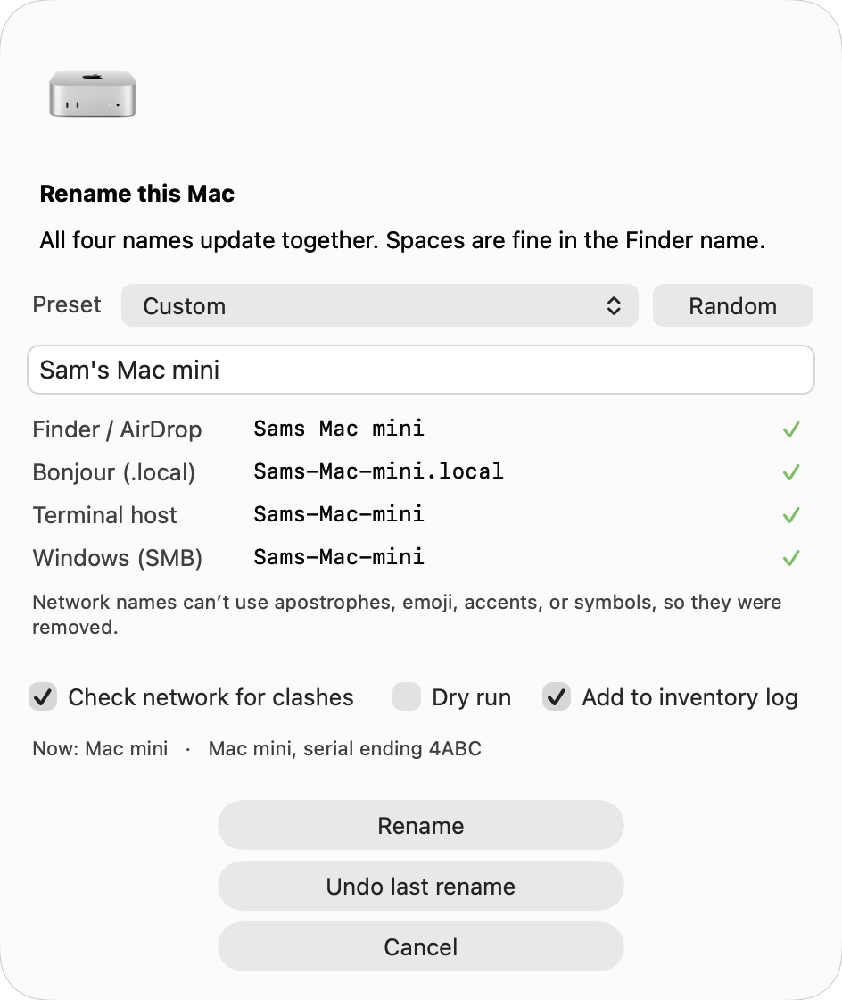
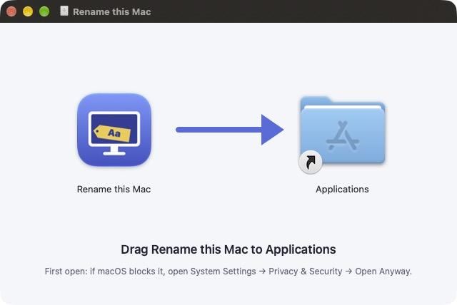

# Rename this Mac

`rename-mac` sets all four of a Mac's names in one step, so Finder, AirDrop, Bonjour, Terminal, and Windows file sharing always agree.
It comes as one zsh file with a Terminal command and a native macOS window.



## Download the app

**[Download Rename this Mac (DMG)](https://github.com/enzocaggiano/rename-this-mac/releases/latest/download/Rename-this-Mac.dmg)**

1. Open the DMG and drag **Rename this Mac** onto **Applications**.
2. Open **Rename this Mac** from your Applications folder.
3. If macOS says it can't verify the app, open System Settings → Privacy & Security, scroll down, and click **Open Anyway**.
    - This happens only once, because the app isn't notarized by Apple.
4. On first launch, choose whether to also add the `rename-mac` command for Terminal.



## Install with Terminal instead

```bash
curl -fsSL https://raw.githubusercontent.com/enzocaggiano/rename-this-mac/main/rename-mac.command -o rename-mac.command
zsh rename-mac.command --install
```

- Answer `y` when the installer offers to update `~/.zshrc`.
- Open a new Terminal window, then run `rename-mac --show` to see your current names.
- Run `rename-mac --dry-run "Sam's Mac mini"` to preview a rename without changing anything.
- Run `rename-mac "Sam's Mac mini"` to rename for real.
    - It asks for your Mac password once.
- Or search Spotlight for **Rename this Mac** to use the window.

## Why this exists

macOS keeps four separate names, and System Settings only updates two of them.

| Name | macOS setting | Where you see it | Example |
|---|---|---|---|
| Finder and AirDrop | `ComputerName` | Finder sidebar, AirDrop, Bluetooth, Sharing | `Sams Mac mini` |
| Bonjour address | `LocalHostName` | SSH and Screen Sharing on your network | `Sams-Mac-mini.local` |
| Terminal host | `HostName` | Your Terminal prompt and the `hostname` command | `Sams-Mac-mini` |
| Windows sharing | `NetBIOSName` | Windows PCs and network drives | `Sams-Mac-mini` |

- The Finder name keeps your spaces.
- The other three use hyphens, because network names can't contain spaces.
- Apostrophes, emoji, accents, and symbols are removed from all four, so "Zoë's 💻 Lab" becomes `Zoes Lab` and `Zoes-Lab`.
- Names longer than 15 characters are refused, because Windows sharing would cut them off.

## Everyday commands

| Command | What it does |
|---|---|
| `rename-mac` | Shows your current names, then asks for a new one |
| `rename-mac "Name"` | Renames this Mac |
| `rename-mac --gui` | Opens the rename window |
| `rename-mac --show` | Shows the four names and flags any that don't match |
| `rename-mac --dry-run "Name"` | Shows the change without making it |
| `rename-mac --undo` | Puts the previous names back |
| `rename-mac --reset` | Uses Apple's default name for this model, like `Mac mini` |
| `rename-mac --random` | Picks a two-word name, like `Quiet Otter` |
| `rename-mac --help` | Lists every option |

## The window

- **Live preview:** all four names update as you type.
- **Warnings:** a name over 15 characters turns the Windows row orange and disables **Rename**.
- **Presets:** the dropdown fills in a name from a preset or template.
- **Dry run:** the checkbox turns **Rename** into **Preview**, so nothing changes.
- **Undo last rename:** restores the names from before your last rename.

## Presets and templates

Templates build a name from facts about the Mac.

| Token | Fills in | Example |
|---|---|---|
| `{first}` | Your first name | `Sam` |
| `{user}` | Your account name | `sam` |
| `{model}` | The Mac's model | `Mac mini` |
| `{serial}` | The full serial number | `C02XK1234ABC` |
| `{serial4}` | The last 4 characters of the serial | `4ABC` |
| `{n}` | A number you pass in | `4` |

- Use a template once with `rename-mac --template "Lab-{serial4}"`.
- Save one as a preset by adding a line like `preset.lab=Lab-{n}` to `~/.rename-mac/config`.
- Use the preset with `rename-mac --preset lab 4`, which gives `Lab-4`.
- Built-in presets are `model` (`{first}'s {model}`) and `reset` (`{model}`).

## Rename other Macs

Turn on **Remote Login** (System Settings → General → Sharing) on each Mac first.

- **One Mac:** `rename-mac --host studio.local Studio`
- **Many Macs:** `rename-mac --batch macs.csv`
    - The file has one `host,new_name` line per Mac.
    - Each Mac asks for its own password, unless it already allows `sudo` without one.
    - A summary at the end shows which Macs were renamed and checked.

```csv
host,new_name
studio.local,Studio
192.168.1.21,Lab-1
192.168.1.22,Lab-2
```

## Safety features

- **Preview first:** every rename shows a before → after table and asks before changing anything.
- **Clash check:** a 2-second network scan warns you if another device already uses the name.
    - Skip it with `--no-clash-check`.
- **Verify:** all four names are read back after the change.
- **Undo history:** every rename is saved in `~/.rename-mac/history.tsv`.
- **Inventory log:** `--log` adds the date, serial, model, old name, and new name to a CSV.
    - The default file is `~/.rename-mac/inventory.csv`.
- **Notification:** a macOS notification confirms each rename.
    - Turn it off with `--quiet`.

## Install details

`--install` adds three things.

- **The command:** `rename-mac`, in `/usr/local/bin` if you can write there, or `~/.local/bin` otherwise.
- **The app:** `~/Applications/Rename this Mac.app`, which Spotlight finds.
- **Tab completion:** for zsh, in `~/.rename-mac/completions`.

To add it to the menu bar, make a Shortcut with **Open App → Rename this Mac** and turn on **Pin in Menu Bar**.

## Uninstall

```bash
rename-mac --uninstall
```

- This removes the command, the app, Tab completion, and the lines it added to `~/.zshrc`.
- It keeps your history, inventory log, and presets in `~/.rename-mac`.

## Known limits

- Some macOS versions block writing the Windows sharing name.
    - When that happens, `rename-mac` says "3 of 4 names changed" and shows the manual fix.
    - The manual fix is System Settings → Network → your connection → Details → WINS → NetBIOS Name.
- The app isn't notarized, so macOS asks you to click **Open Anyway** the first time.
- Shortcuts can't be created by a script, so pinning to the menu bar is a manual step.
- It has been tested on macOS 27 only.

## Build the DMG yourself

```bash
zsh build-dmg.sh
```

- This draws the icon, builds the app with the script inside, and writes `dist/Rename-this-Mac.dmg`.
- macOS asks once whether Terminal may control Finder, which lays out the installer window.

## Run the tests

```bash
zsh test-rename-mac.zsh
```

- The tests cover name cleaning, templates, presets, argument parsing, CSV, and history.
- They never change your Mac's names.

## How it works

- Name cleaning runs in JavaScript for Automation, so the Terminal command and the window always produce the same names.
- The window is a native `NSAlert` built with JavaScript for Automation, so it needs nothing installed.
- Renaming uses `scutil` for the first three names and the SMB server preferences for the Windows name.
- After a rename, it flushes the DNS cache and restarts Bonjour so the new name answers right away.

## License

[GNU General Public License v3.0](LICENSE).
